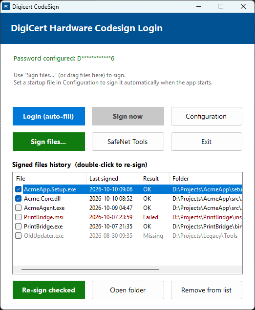
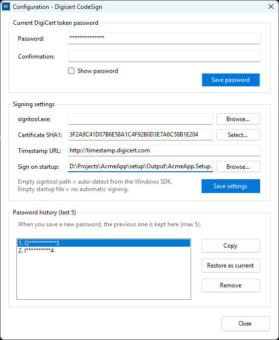

# Digicert CodeSign

A small Windows tool that removes the most annoying part of signing code with a DigiCert certificate on a hardware token: typing the token password into the SafeNet **Token Logon** dialog every time `signtool` runs.

It signs files with `signtool.exe`, watches for the SafeNet Token Logon dialog, fills in the token password and clicks **OK** for you. It also keeps a history of signed files so you can re-sign a build with a double-click.

> [!WARNING]
> This tool stores your token password on disk (encrypted for your Windows account) and enters it automatically.
> Read [Security considerations](#security-considerations) before using it.



## Why

Since June 2023, publicly trusted code signing certificates (OV and EV) must keep their private key on a hardware token or HSM. With a DigiCert certificate on a SafeNet / Thales eToken, every `signtool sign` call can bring up the SafeNet Token Logon dialog, which breaks build scripts and makes signing a batch of files tedious.

This tool keeps the private key on the token. It only automates typing the password into the dialog.

## Features

- **Sign files** with a file picker, or by dragging files onto the window (`.exe`, `.dll`, `.msi`, `.msix`, `.appx`, `.cab`, `.sys`, `.ocx`, ...).
- **Automatic Token Logon:** the SafeNet password dialog is detected through Windows UI Automation, filled in and confirmed.
- **Login (auto-fill) mode:** keeps the watcher running while your own build scripts or installers call `signtool`, so their Token Logon prompts are also answered.
- **Sign on startup (optional):** sign a configured file, such as your installer, as soon as the app starts.
- **Signed files history** (last 100 files) showing date, result (OK / Failed / Missing) and folder:
  - double-click or <kbd>Enter</kbd> to re-sign, checkboxes to re-sign several files at once
  - <kbd>Delete</kbd> to remove entries, <kbd>Ctrl</kbd>+<kbd>A</kbd> to select all
  - **Open folder** to open the file's location in Explorer
- **Password history:** the last 5 token passwords are kept, so you can restore one after a token password change.
- **Certificate picker:** choose the code signing certificate from your personal store instead of copying its thumbprint by hand.
- **signtool auto-detection:** uses the newest `signtool.exe` from the installed Windows 10/11 SDK.

## Requirements

- Windows 10 or 11
- .NET Framework 4.0 or later (included in Windows)
- [Windows SDK](https://developer.microsoft.com/windows/downloads/windows-sdk/) signing tools (`signtool.exe`)
- SafeNet Authentication Client (provided by DigiCert with the token), with the hardware token connected
- A code signing certificate on the token, visible in the *Current User → Personal* certificate store

## Build

Open `DigicertCodeSign.sln` in Visual Studio and build, or from a Developer Command Prompt:

```bat
msbuild DigicertCodeSign.sln -p:Configuration=Release
```

The output is `DigicertCodeSign\bin\Release\DigicertCodeSign.exe`. The tool is a single executable with no external dependencies.

## Configuration

Open **Configuration** on first run.



| Setting | Description |
|---|---|
| **Password** | The DigiCert / SafeNet token password. Saving a new one moves the previous one into the password history (max 5). |
| **signtool.exe** | Path to `signtool.exe`. Leave empty to auto-detect the newest one from the Windows SDK. |
| **Certificate SHA1** | Thumbprint of your code signing certificate (passed as `signtool /sha1`). Use **Select...** to pick it from the certificates that have a private key and the *Code Signing* usage. |
| **Timestamp URL** | RFC 3161 timestamp server. Defaults to `http://timestamp.digicert.com`. |
| **Sign on startup** | Optional. A file signed automatically when the app starts and by the **Sign** button. Leave empty to turn this off. |

Each file is signed with:

```bat
signtool sign /tr <timestamp-url> /td sha256 /fd sha256 /sha1 <thumbprint> "<file>"
```

## Usage

1. Connect the token and start the app.
2. Click **Sign files...** or drag files onto the window.
3. When SafeNet asks for the token password, the app fills it in and clicks **OK**. The result appears in the history list.

To sign from your own scripts or build tools, click **Login (auto-fill)** and leave the app running. Any Token Logon dialog that appears is answered automatically. Once the token is logged in, SafeNet usually keeps the session open, so later `signtool` calls in your scripts will not prompt again.

**SafeNet Tools** opens SafeNet Authentication Client (`SACTools.exe`) for token management.

## Data storage

All data is stored per Windows user in `%APPDATA%\DigicertCodeSign\`:

| File | Content |
|---|---|
| `settings.xml` | Current token password and password history, encrypted with Windows DPAPI (`CurrentUser` scope) |
| `signing.xml` | signtool path, certificate thumbprint, timestamp URL, startup file (plain text) |
| `history.xml` | Signed files history (plain text) |

Delete the folder to remove all data.

## Security considerations

Please read this before using the tool. Convenience comes at a cost.

- **The token password is stored on disk.** It is encrypted with Windows DPAPI and bound to your Windows account, so other users on the machine cannot read it. Any program running under *your* account, including malware, can decrypt it. Up to 5 previous passwords are stored the same way.
- **Anyone who can use your Windows session can sign code.** With the token connected and the app running, a signing request is approved without anyone typing the password. That removes the "something you know" factor that the token password provides.
- **Copying from the password history** puts the password in the Windows clipboard, where other applications (and clipboard history, if enabled) can read it.
- **Your certificate agreement still applies.** Code signing certificates are issued under the CA's subscriber agreement, which requires you to protect the private key and its activation data (the token password) and to report a suspected key compromise. Whether automating the password entry is acceptable for your organization's policy is your decision.

Recommendations:

- Lock your workstation (<kbd>Win</kbd>+<kbd>L</kbd>) and unplug the token when you are not signing.
- Prefer a dedicated, locked-down build machine for automated signing.
- Do not run the app on shared or untrusted computers.
- As an alternative, SafeNet Authentication Client has a built-in **single logon** option (*Advanced View → Client Settings → Advanced → Enable single logon*), which keeps the token logged in after you enter the password once.

**Use this tool at your own risk.** It is provided "as is", without warranty of any kind. See [LICENSE](LICENSE).

## Limitations

- The Token Logon dialog is detected by its window title (`Token Logon` and common variants, including Romanian). Other localizations may need changes in [`SafeNetAutoLogin.cs`](DigicertCodeSign/SafeNetAutoLogin.cs).
- SafeNet Tools is expected at the default install path, `C:\Program Files\SafeNet\Authentication\SAC\x64\SACTools.exe`.
- Signing always uses SHA-256 for both the file digest and the timestamp.

## Disclaimer

This is an independent project. It is not affiliated with, endorsed by, or supported by DigiCert, Inc., Thales Group or Microsoft. *DigiCert* is a trademark of DigiCert, Inc.; *SafeNet* is a trademark of Thales. These names are used only to describe compatibility.

## License

[MIT](LICENSE) © 2026 Dan Vaduva
